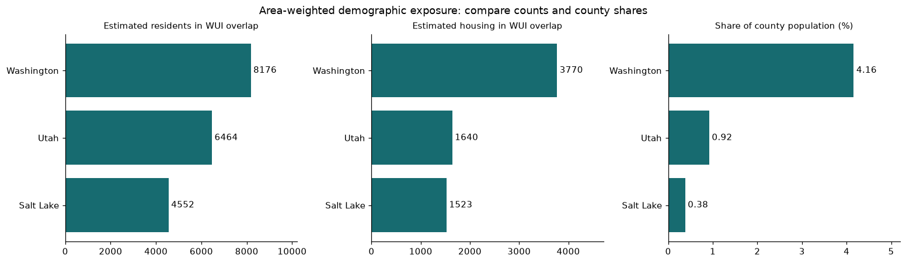
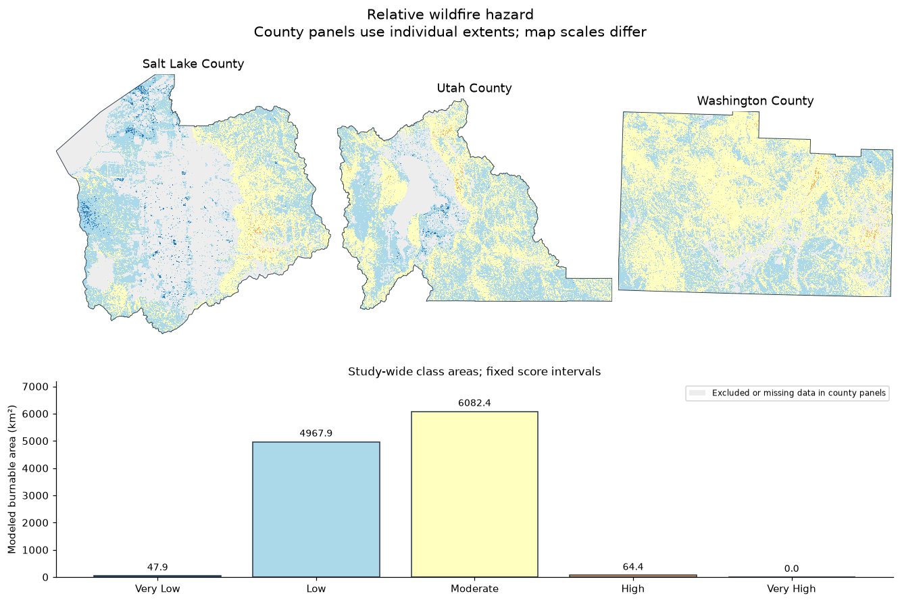
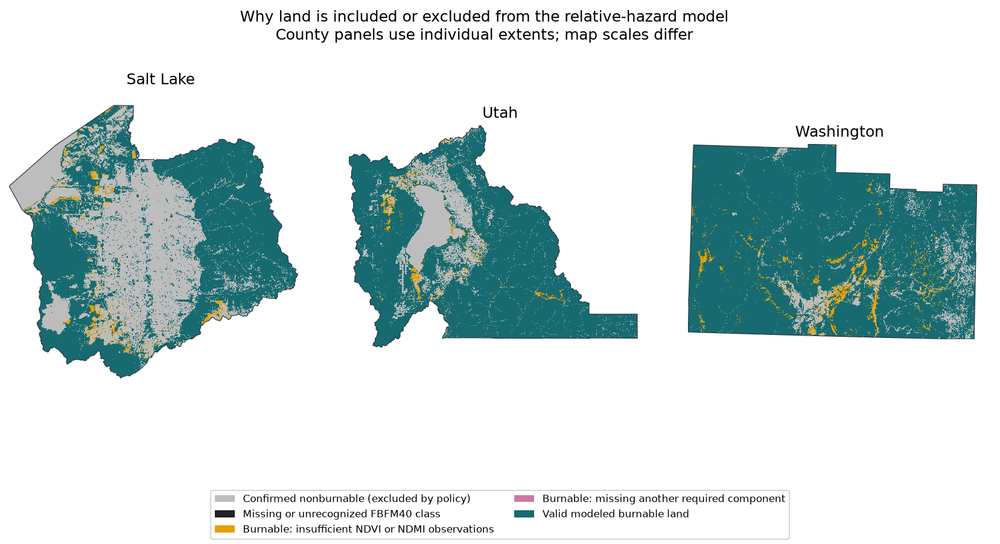

# Utah WUI exposure and wildfire occurrence modeling

A geospatial data-science portfolio project connecting a complete ETL pipeline to
county exposure estimates, transparent raster modeling, and an interactive dashboard
for Salt Lake, Utah, and Washington counties.

The ML phase adds a separate development case study of annual recorded wildfire occurrence,
with temporal and geographic validation, probability calibration, ranking comparisons, and
an audit of unequal cell areas. The descriptive dashboard and ML study answer different questions.

## Explore

- **[Retrospective forecasting case study](https://aval0311.github.io/utah-wui-exposure-analysis/forecasting/):** fixed chronological experiments within reviewed 2001–2021 history; a smoothed cell-history baseline outperformed the terrain-plus-climate model. Includes evaluation design, saved results, and limitations.
- **[Historical timeline + ML comparison](https://aval0311.github.io/utah-wui-exposure-analysis/history/):** explore reviewed 2001–2021 occurrence alongside saved 2013–2021 predictions, matched-cohort charts, probability maps, and findings. Includes county filters, a year slider, cell histories, and reporting limitations.
- **[ML v1 development case study](https://aval0311.github.io/utah-wui-exposure-analysis/ml/):** annual recorded wildfire occurrence, development 2001–2021, with nine annual map pairs and disclosed reporting and area limitations.
- **[ML release download](https://github.com/aval0311/utah-wui-exposure-analysis/releases/tag/ml-v1.0.0):** complete offline viewer, map atlas, executed snapshot notebook, saved evidence, and checksums.
- **[Live dashboard](https://aval0311.github.io/utah-wui-exposure-analysis/):** explore wildfire exposure, relative hazard, and facility proximity across Salt Lake, Utah, and Washington counties.
- **[Analysis notebook](notebooks/utah_wui_exposure_analysis.ipynb):** saved results, methods, code, and checks.
- **[Dashboard HTML](docs/index.html):** download and open locally in a browser; internet is required for browser libraries and basemap tiles.
- **[County results](outputs/tables/county_exposure.csv)** and **[coverage diagnostics](outputs/tables/hazard_coverage.csv)**.
- **[Reproduction guide](data/README.md)** and **[publication handoff](RELEASE_HANDOFF.md)**.

GitHub's notebook preview displays saved figures and tables. Interactive exploration
uses the standalone dashboard. Browser libraries and basemap tiles require internet.

## Questions and contribution

1. Where does mapped high-risk WUI intersect Census block groups?
2. How do estimated population and housing overlap differ between counties?
3. Which facilities intersect or lie near those WUI polygons?
4. How do six environmental indicators combine into a relative hazard surface?
5. What computation-time and memory tradeoff does local parallel processing provide?

The pipeline preserves source snapshots, standardizes identifiers and spatial references,
performs overlap-safe vector analysis, aligns a 30 m raster grid, records missing-data
coverage, validates outputs, and exports a responsive Folium dashboard. Xarray and
rioxarray retain grid coordinates; Dask parallelizes the final composite with local workers.

## Results from the accepted release

<!-- RELEASE_RESULTS_START -->
Accepted snapshot run: **20261012T180540Z_eb3fdcb7**, completed **2026-10-12 UTC**.
This summary is synchronized from exported tables; new execution results appear later in the notebook.

| County | Estimated residents in mapped WUI | Estimated housing units | Share of county population |
|---|---:|---:|---:|
| Salt Lake | 4,552 | 1,523 | 0.38% |
| Utah | 6,464 | 1,640 | 0.92% |
| Washington | 8,176 | 3,770 | 4.16% |

Washington County has the largest estimated exposed population and the highest share of county residents within mapped WUI. These area-weighted estimates describe mapped WUI overlap, not population within a modeled hazard class.

The study footprint totals **13,927.71 km²**.

| Coverage category | Study area (%) |
|---|---:|
| Confirmed nonburnable (excluded by policy) | 17.10 |
| Missing or unrecognized FBFM40 class | 0.00 |
| Burnable: insufficient NDVI or NDMI observations | 2.59 |
| Burnable: missing another required component | 0.16 |
| Valid modeled burnable land | 80.15 |

County panels are polygon-masked. Nonburnable land and missing observations have separate exclusion categories.

Sensitivity uses **13,591** modeled sample pixels.

- Equal weights: **85.27%** class agreement; top-quintile Jaccard **0.631**.
- Half history influence, renormalized: **88.14%** class agreement; top-quintile Jaccard **0.867**.

These comparisons assess stability under assumed weights.

Historical selection retained **20,853 recorded wildfires** in the density rectangle, including **4,689 inside the county polygons**. Prescribed fires are excluded.

This complete snapshot run took **24.1 minutes**, measured from configuration through input verification, processing, and snapshot-inventory finalization. This single functional-validation timing is separate from the retained composite benchmark.

<!-- RELEASE_RESULTS_END -->

## Methods and interpretation

Spatial analysis uses EPSG:26912. Population and housing estimates allocate 2024 ACS
five-year values by mapped WUI overlap with 2020 block groups. This assumes uniform
density within a block group; allocated margins of error omit spatial-allocation uncertainty.
Facility proximity is Euclidean distance. The one-mile screening flag is a project rule,
and popup demographic values describe the containing block group.

The relative score combines fuels (30%), vegetation dryness (20%), slope (15%), aspect
(10%), historical wildfire occurrence (15%), and human-activity indicators (10%).
The notebook explains transformations, thresholds, and rationale beside each phase.
These are explicit project assumptions. The continuous index is 1 + 9 × normalized score;
fixed boundaries at 0.2, 0.4, 0.6, and 0.8 define five descriptive classes.

Recorded InFORM wildfires are filtered to IncidentTypeCategory=WF, with discovery dates
from 1992-01-01 inclusive to 2026-09-30 exclusive (UTC). A documented bounding rectangle
retains surrounding events for density smoothing; actual county counts are reported separately.
Source vintages differ. This release provides a relative screening analysis rather than
calibrated probabilities of ignition, loss, or fire behavior.

## Quality and limitations

Checks cover geometry, joins, exact raster alignment, input checksums, temporal support,
nonburnable exclusions, coverage reconciliation, component formulas, and serial/Dask agreement.
See [current release evidence](evidence/release_validation.json) for completed checks and their scope.

- Confirmed nonburnable and incomplete cells are excluded for different reasons.
- HLS sampling and quality masks leave some burnable land without sufficient observations.
- MTBS perimeters are unavailable in this snapshot. The retained 60/40 history formulation
  assigns zero to the missing perimeter term and caps the component at 0.60.
- The canonical mask differs from independent county reconstruction at 208 cells (0.1872 km²
  in the retained footprint). Its original cause is unresolved; each run measures the difference.
- Infrastructure records can be incomplete or imprecise; shelter points do not establish
  operating status. Historical fire reporting is incomplete and varies over time.
- Weight sensitivity assesses stability. Predictive accuracy has not been established for this index.

## Reproduce the analysis

Keep the notebook with src/, scripts/, and the environment specification. If the tested
wui-professional-314 environment already exists, activate it and select its kernel in JupyterLab.
To create the environment on another compatible machine:

    mamba env create -f environment.yml
    mamba activate wui-professional-314
    python -m ipykernel install --user --name wui-professional-314
    jupyter lab

Extract **wui-snapshot-publication-v3.zip** into a separate writable workspace. Set
WUI_PROJECT_ROOT before starting Jupyter, or set PROJECT_ROOT_OVERRIDE in the configuration
cell. Restart the kernel and run all cells. Full steps and checksum verification are in the
[data guide](data/README.md). Saved outputs and the dashboard can be reviewed without the snapshot.

Defaults are DATA_MODE="snapshot", REBUILD_DERIVED=False, and HPC_ENGINE="dask".
Snapshot execution uses retained sources and frozen responses. Refresh intentionally reacquires
sources and requires a Census API key through an environment variable or hidden prompt.
Rebuilding derivatives uses the selected acquisition mode and never silently enables downloads.
The snapshot network guard applies to the notebook kernel's Python socket calls; it is not an
operating-system or worker-process firewall.

Four local workers have a 4 GiB limit each. The client and upstream arrays need additional RAM;
the validated machine has approximately 32 GiB. Worker count and chunk size are configurable.
Allow space for the approximately 27 GB archive, extraction, derived products, and new outputs.
Preserve the downloaded archive as the immutable starting copy.

Each execution writes a unique outputs/publication/RUN_ID/ directory in the selected workspace.
After an accepted execution, export that run to update the package's dashboard, figures,
tables, notebook opening summary, and README together:

    python scripts/export_publication.py /path/to/workspace --run /path/to/workspace/outputs/publication/RUN_ID

Run current equivalence and browser checks before replacing release evidence. Recreate
release checksums after changes. Running notebook cells alone does not rewrite the
accepted-run summaries in the opening Markdown or README.

## Parallel-processing evidence

A retained matched experiment used identical frozen composite inputs, one warm-up, and five
measured runs per configuration. It predates v3's wildfire-only source selection.

| Configuration | Median compute/export | Median peak process-tree RSS |
|---|---:|---:|
| Rasterio/NumPy | 38.711 s | 2.960 GiB |
| Dask, 1 worker, 1024 × 1024 | 65.282 s | 2.268 GiB |
| Dask, 4 workers, 1024 × 1024 | 22.559 s | 5.252 GiB |
| Dask, 4 workers, 2048 × 2048 | 17.673 s | 5.510 GiB |

The selected configuration achieved **2.19× compute/export speedup**, or **1.90× including
cluster startup and teardown**, using approximately **1.86× memory**. All 96 retained output
comparisons passed. These warm-cache, local-host measurements apply to the recorded composite
workload. Upstream ETL remains conventional Python GIS; multi-node scaling is future work.
The [protocol](evidence/step4_report.txt) and [measurements](evidence/benchmark_summary.json)
document timing boundaries, hardware, and sampling limitations. Current equivalence evidence
is separate from that historical experiment.

## ML v1 development case study

The [published ML study](https://aval0311.github.io/utah-wui-exposure-analysis/ml/)
estimates the annual probability of at least one **recorded wildfire discovery** within
a county-clipped grid cell, using UTC calendar years. The study covers 997 nominal 4 km
cells, including non-WUI land. It uses 14 terrain/area variables and six antecedent climate
variables; the descriptive weighted hazard score is not the training label.

The frozen recommendation is conservative intercept-calibrated XGBoost for probability
estimation, with raw XGBoost as the ranking reference and sigmoid-calibrated Random Forest
as the benchmark. The 2013–2021 annual development backtest combines 45 geographic fits
and 8,588 eligible held-out cell-years, with 656 recorded positives.

| Model | Mean annual Brier score | Mean annual top-10% recall |
|---|---:|---:|
| Conservative XGBoost | 0.070814 | 17.42% |
| Raw XGBoost | 0.071353 | 18.09% |
| Sigmoid Random Forest | 0.071341 | 16.13% |

The probability improvement over past-rate references is approximately 1% relative and
is modest. These development years informed model and calibration choices; this is not
an untouched independent final evaluation. Full cells account for approximately 75% of
eligible cell-years and 98% of top-decile selections. Cell area materially affects interpretation.
Reporting changes around 2020 and remaining underprediction are unresolved. Climate inputs
are retrospective reconstructions with an assumed 60-day availability lag; historical
as-issued availability is unverified. A no-record label does not prove that no fire occurred.

Read the [frozen specification](docs/ml/data/frozen_specification.json),
[area audit](docs/ml/AREA_AUDIT.md), [sources](docs/ml/SOURCES.md), and
[reproduction limits](docs/ml/REPRODUCIBILITY.md). The package reproduces the presentation
and saved evidence, without the full training inputs or fitted models. Publication generated
no new predictions and performed no analysis of 2024–2025. These maps do not estimate
property loss, burn severity, daily fire danger, or hazard per square kilometer.

The [ML package README](docs/ml/README.md) explains offline viewing and integrity checks.
The original descriptive notebook, dashboard, and analytical outputs remain unchanged.

## Package layout

- notebooks/: executed analysis and narrative.
- src/wui/: runtime, analytical helpers, parallel computation, validation, and publication support.
- scripts/: regression checks and publication export.
- data/: matching snapshot inventory, checksum, and acquisition guide.
- images/ and outputs/tables/: accepted-run figures and tables.
- docs/index.html: interactive descriptive dashboard for GitHub Pages.
- docs/ml/: immutable ML v1 publication package, served at /ml/.
- evidence/: current validation and explicitly retained historical evidence.

The [file checksum manifest](release_file_checksums.json) records SHA-256 hashes and byte
sizes for tracked publication files as stored by Git, excluding the manifest itself.
These describe the current repository contents; Windows working copies can use different
line endings. Execution reports retain the hashes of the original validated release artifacts.

Original code and documentation use the [MIT License](LICENSE). Third-party datasets retain
their providers' terms and attribution requirements.
