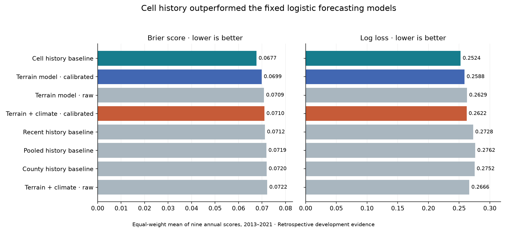
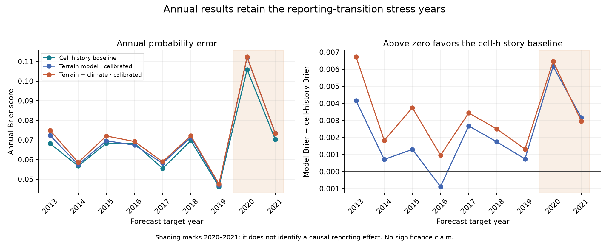
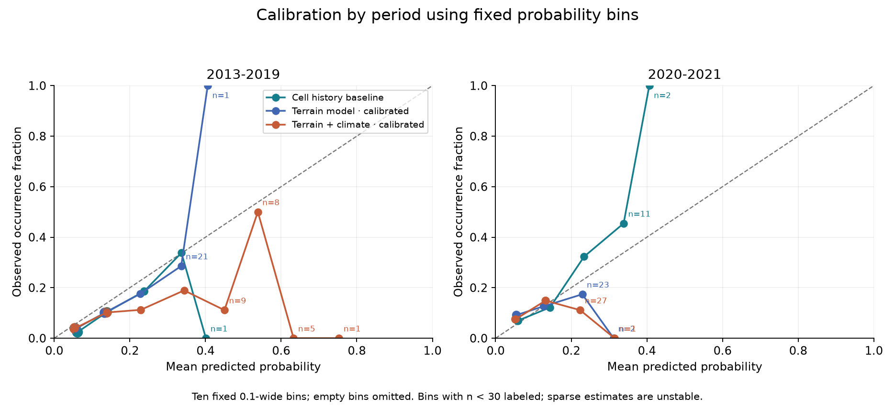

# Retrospective wildfire occurrence forecasting results

> **Archived original-run report — publication note added October 18, 2026.** The report below preserves the findings and execution-time wording of the completed retrospective experiment. References to “nothing was published,” local-only writes, and a future review describe that original stage, before the portfolio and code package were published.
>
> **Included in this package:** this report and its three saved figures, annual/method/county summary scores, the frozen configuration, and the original verification record (packaged as `original_verification.json`), alongside the code and specification. **Retained separately:** model artifacts, cell-level predictions and labels, fit ledgers, input/prediction/evaluation manifests, and the incomplete `run_001` attempt. Paths to those items below describe the original workspace, not files in this download. See [the package README](../README.md) and [reproducibility guide](../REPRODUCIBILITY.md) for the available verification steps and exact-rerun requirements.
>
> The figures were copied unchanged from the sealed run; this presentation update performs no new fitting or evaluation. Existing releases and 2022–2025 observations remain untouched.

**The fixed terrain-plus-climate model did not improve on the cell-history baseline. Retain cell history as the reference method for this retrospective experiment.** Its lower Brier score and log loss do not establish operational readiness or independent future performance.

The primary candidate's mean annual Brier score was **0.07101**, compared with **0.06768** for cell history: an increase in error of 0.00333, or **4.91% relative to the baseline**. Cell history had lower Brier score in all nine forecast years. The primary candidate therefore fails the prespecified numerical recommendation gate. No post-result tuning or additional model search was performed.

## Experiment and scope

The experiment used reviewed target years 2001–2021, forecasting 2013–2021 at the same 997 cells. For each target T, base training ended at T−4, calibration used T−3 and T−2, and historical baselines used eligible labels through T−2. December 1 T−1 was the data cutoff, followed by a proposed December 15 issue date. Inputs use the agreed contemporary-static-terrain and retrospective-climate assumptions. Historical publication and revision vintages remain unverified.

There were 18 logistic model fits, 18 imputer/scaler fits and 18 successful intercept-only calibration fits. All models used fixed L2 regularization C=1, without interactions, class weighting or tuning. M0 used five terrain/area inputs; M1 added six antecedent climate inputs. Calibration applied half the fitted intercept offset, with slope fixed at one. The four historical baselines retained the specified smoothing formulas.

Predictions cover all 997 cells in all nine target years for all eight method variants: **71,784 rows**. Each method was evaluated on the same **8,588 eligible cell-years and 656 positives** after excluding 230 unknowns and 155 flagged zeros in 2013–2021. Across the full development history, 231 unknowns and 155 flagged zeros were excluded from fitting eligibility. Exclusion rules and original labels were not changed.

## Probability comparison

Scores below give each target year equal weight. Bias is mean predicted probability minus observed occurrence, in percentage points. Lower Brier score and log loss are better; bias closest to zero is better calibrated in the aggregate, but does not by itself indicate useful geographic discrimination.

| Method | Mean annual Brier | Mean annual log loss | Mean annual bias in pp |
| --- | ---: | ---: | ---: |
| Cell history baseline | 0.06768 | 0.25239 | +2.73 |
| Terrain model · calibrated | 0.06988 | 0.25883 | +1.52 |
| Terrain model · raw | 0.07087 | 0.26294 | +3.21 |
| Terrain + climate · calibrated | 0.07101 | 0.26219 | +2.00 |
| Recent history baseline | 0.07125 | 0.27282 | +0.16 |
| Pooled history baseline | 0.07186 | 0.27620 | +2.83 |
| County history baseline | 0.07196 | 0.27523 | +2.83 |
| Terrain + climate · raw | 0.07224 | 0.26659 | +3.64 |

The calibrated M0 terrain model outperformed calibrated M1 in average Brier score. In this fixed logistic specification, adding the six antecedent climate inputs did not improve average probability accuracy. This does not show that climate is irrelevant to wildfire, nor that alternative climate models would necessarily perform better.

The recent-history baseline has smaller average signed bias than cell history, while cell history has better Brier score and log loss. Thus the recommended reference still needs calibration scrutiny: its mean annual probability exceeds the observed rate by 2.73 percentage points. We did not introduce a new calibration procedure for that baseline after seeing the results.

## Annual and geographic failures

The primary candidate's annual Brier difference from cell history ranges from +0.00096 to +0.00673; every difference favors the baseline. The calibrated terrain-only model beats cell history in one of nine years. These are paired descriptive comparisons across previously studied years, without a significance claim.

The reporting-transition years were retained. In 2020, the primary model underpredicts occurrence by 4.11 percentage points and cell history underpredicts by 3.28 points. In 2021, both overpredict. Reporting changes, missing labels and real occurrence variation cannot be separated causally from these comparisons. The primary candidate's mean 2020–2021 Brier is 0.09283 versus 0.08811 for cell history.

| County | Cell history Brier | Calibrated terrain Brier | Calibrated terrain and climate Brier |
| --- | ---: | ---: | ---: |
| Salt Lake | 0.04729 | 0.04916 | 0.04957 |
| Utah | 0.05686 | 0.05949 | 0.06029 |
| Washington | 0.08532 | 0.08732 | 0.08900 |

County entries are equal-weight means of the nine county-year scores, using frozen primary-county assignment. They are not weighted to reproduce the overall annual score. Full county-year results, including class counts and bias, are in `county_year_metrics.csv`.

## Ranking and calibration

Cell history captures an average **28.9%** of positive cells in the top 10% annual cell budget, compared with **14.6%** for the primary model. The budget is ceil(10% of eligible cells), with cell_id breaking ties. It is not land area, incident count or suppression benefit. Constant-probability baselines have arbitrary tie rankings, so their tie-based capture values are not evidence of geographic skill.

Within a year, intercept calibration preserves each logistic model's ranking. The raw and calibrated versions consequently have the same annual AUC, average precision and top-decile membership. This experiment trains one model per year across these same cells; it does not test transfer to new counties.

Calibration plots pool cell-years within each displayed period and use fixed bins. Annual metrics remain the primary aggregation. Sparse bins should not be interpreted as precise estimates. No confidence bands based on independent cell-years are claimed.

## Verification and reproducibility

Six synthetic contract tests passed before training. After fitting, verification independently recomputed training medians, means and scales; replayed all 18 saved logistic models from their numeric JSON parameters; checked calibration roots; replayed all 36 baseline/year combinations; checked fit membership; and recomputed 72 annual Brier scores. These checks required no refitting. Prediction hashes confirm that the same saved forecasts were evaluated.

`frozen_config.json` records numerical settings and library versions. `models/` contains portable coefficients, preprocessing values and offsets, plus historical counts. `fit_membership.csv` records the rows available to each role. `fit_feature_missingness.csv` records missing inputs by fold and model. `input_manifest.json`, `prediction_manifest.json`, `evaluation_manifest.json` and `verification.json` record lineage and checks.

The first attempt is preserved separately in `../run_001`. It stopped at a Windows library-loading fault before saving any fitted model or predictions. A process-local Conda PATH initialization fixed the runtime; the successful run retained the same solver and statistical settings. Synthetic runtime diagnostics are separate from the 18 development fits. No package installation or system configuration change was made.

## Interpretation and next step

The supported finding is that **past recorded occurrence at these same cells is a stronger development reference than the fixed terrain/climate logistic candidates**. A more complex model is not justified by this experiment alone. The published XGBoost recommendation belongs to a different evaluation design and was neither retrained nor replaced.

Treat the cell-history method as a retrospective reference, not a deployable forecast. All years were already used in project development; static terrain, retrospective climate vintages, delayed labels, QA exclusions, unequal areas and reporting changes limit generalization. The appropriate local review is to examine these results and accept or reject the experiment's conclusion. Any revised specification would be a new development experiment, not a correction to these frozen results.

**2022–2025 observations remained untouched.** All consumed original inputs retain their audited hashes. Writes were confined to the new local experiment folder. Published releases and the public Git repository were not modified, and nothing was published.
